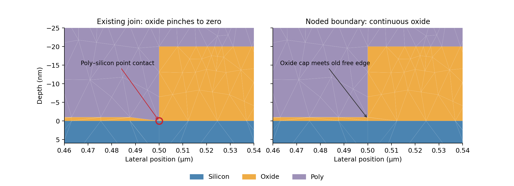

# RIT CMOS finite-element repair, 2026-11-18

Work in progress. **Full CMOS process and electrical qualification are not complete.** This follows the [presentation audit](rit_cmos_presentation_audit_20261117.md); no implant dose, physical oxide thickness, activation volume or threshold parameter has been adjusted to obtain convergence.

Current qualification summary:

| Scope | Status |
|---|---|
| Fresh NMOS/PMOS through LOCOS mask | Both pass all five independent checkpoint audits |
| Captured full PMOS LOCOS sequence, main source | Pass; independently audited; byte-identical to successful isolated candidate |
| Corrected NMOS poly implant, original first 12-minute activation hold | Pass with opt-in SG flux; independently audited |
| Remaining activation ramps | Pass; checkpoint continuation; independently audited |
| Whole-film normal mesh metric | Not qualified; finer control exposes coarsening/resolution failure |
| NMOS/PMOS post-LOCOS through gate oxide, combined main candidate | Both pass 8/8 checkpoint audits; checkpoint continuation, not fresh full flow |
| Corrected native joins, complete original 117-minute NMOS poly activation | Pass in one invocation; body polarity restored; channel mesh convergence still unqualified |
| Fresh complete CMOS and new electrical results | Not qualified |

The working tree contained diagnostic rollbacks of deposition sizing and material-specific implantation when this continuation started. Continuation experiments use an isolated snapshot of the previous `native64_sh1zoeau` candidate, with individual fixes recorded in `experiments/repair_continuation_20261118`. The original working-tree diff is preserved in `prior_working_tree.patch`. The main source now again contains the tested sizing and implant fixes. The experimental global proximity merge in `sp_edge.c` was removed: proximity alone does not establish that two vertices have compatible material topology. Opt-in diagnostics are retained. The general launcher has not been promoted.

## Latest result: two independent root causes repaired

The combined **main-source** candidate `build/native64_5njvfhlt/src/suprem4` (SHA-256 `4faff95b241d95304832178f3b39752759b69a47f675ed4f43a4e359f97d52dc`) completed both saved-LOCOS continuations through gate oxide: **NMOS 8/8 checkpoints, exit 0, 39.58 s; PMOS 8/8, exit 0, 48.88 s**. Evidence: `experiments/repair_continuation_20261118/main_native_optimal_gate/results.json`. These include independently audited inherited prefix checkpoints; the newly executed suffix starts after LOCOS. This result supersedes the earlier unresolved post-LOCOS status below. It does not establish a fresh, single-invocation complete process.

### Positive-width native oxide joins

The old native-film construction retained old oxide geometry by tapering a new film to zero at its joins. A blanket poly deposition then made **14 actual Si/Poly point contacts**, despite positive triangles and a valid geometric partition. This is a physical dielectric pinch-out, not merely a viewer artifact. NMOS body phosphorus was already `5.222874932e19 cm^-3` at 50 nm below the surface after poly activation; the subsequent source/drain phosphorus implant did not cause that contamination. See `blanket_poly_adjacency.json` and `body_polarity_trace.json` in the evidence directory.

`SUPREM4_NATIVE_JOIN_CAP=1` now follows the existing oxide free boundary to the exposed-run offset, nodes the intersected edge, and triangulates a gas-side cap of positive width. It preserves the old inner Si/Ox interface and retains the old free-boundary subdivisions during construction. It neither merges nearby points nor moves old oxide to conceal a gap. Exact rounded-child orientation, polygon simplicity, cap attachments and the completed mesh embedding are checked. `mesh_trial_validate_embedding(0, ...)` exposes the existing read-only embedding validator for this constructor.

This is a bounded construction, **not a complete global Boolean union or fully atomic geometry transaction**. Ambiguous boundaries and chains reaching another exposed run before reaching the offset are explicitly refused. The option remains opt-in; the launcher is unchanged. Legacy nonjoined-endpoint and nitride behavior is preserved.

The minimal counterexample exits zero with the historical taper but fails dielectric separation. The corrected main candidate passes with zero Si/Poly contacts. Its sanitized counterpart `native64_e247k5pa` also passes (`native_join_main_sanitized/result.json`). ASan/UBSan controls pass bare silicon, a wedge, a two-sided gap and a complete exposed island loop. The gap test samples actual oxide coverage rather than requiring an arbitrary interior mesh vertex. Vertex-preservation controls use the conservative mesh-patch remover; the legacy remover can discard now-internal vertices. Sanitizer leak detection is disabled because the host prevents LeakSanitizer operation; this is not a leak-check result.

For the complete unchanged **117-minute** activation recipe, the isolated cap candidate `native64_23mela6p` plus SG flux completed in **1416.505 s**, exit zero, one invocation (`nmos_native_chain_activation`). It passed independent topology, partition, finite/nonnegative dopants, dielectric separation and the device body-polarity check. At body x=1.25 um, depth 50 nm:

| Quantity | Historical pinched geometry | Corrected joins |
|---|---:|---:|
| Phosphorus, cm^-3 | 5.222874932e19 | 6.419009989e16 |
| Boron, cm^-3 | 1.20486e17 | 1.096924968e17 |
| Net body polarity | Wrong, n type | Correct, p type |

The phosphorus reduction is about **814 times**, without changing dose or thermal budget. The main candidate includes the same construction with additional allocation, polygon and embedding guards. Its full activation has not yet been rerun. The channel at x=6 um, depth 5 nm remains donor rich (`P=1.710231431e17`, `B=2.445196109e16 cm^-3`); this is not accepted as a qualified gate-channel profile. The separate coarse-oxide transport error described below remains real. A numerical activation pass and correct deeper body polarity do not establish electrical accuracy.

### Optimal cavity triangulation replaces greedy repair

The cap alone did not resolve the PMOS vertical-growth stall. Read-only tracing at the captured 1098.75 s state proved repeated **quality-guard refusals**, with clear removal flags and a single material owner. The interior Si point was approaching the moving interface to one binary32 coordinate ULP. This disproved the speculative stale-removal-queue explanation; no queue workaround was promoted.

All five legal triangulations of the captured five-vertex cavity were enumerated independently with exact rational orientation predicates:

| Minimum mean-ratio triangle quality | Value |
|---|---:|
| Old cavity | 7.43926272526972e-7 |
| Greedy replacement | 5.070344834820406e-7 |
| Optimal replacement | 0.839698960598487 |

The strict guard correctly rejected the greedy candidate. The algorithm had failed to find an admissible repair. `mesh_patch.c` now maximizes the worst triangle quality across all valid polygon triangulations using dynamic programming: `Q(i,j)=max_k min(Q(i,k),Q(k,j),q(i,k,j))`. Exact stored-float orientation, valid diagonals and in-cone tests handle nonconvex cavities. Time is cubic and memory quadratic in cavity valence; the existing valence bound and checked allocations limit cost. The quality metric and acceptance threshold are unchanged. Partition, boundary attachment, overlap, conservative transfer and atomic-commit checks remain in force.

The general triangulation-DP approach is established in computational geometry; see [Keil and Vassilev, CCCG 2003](https://web.cs.dal.ca/~cccg/papers/19.pdf). Their objective is area; our recurrence optimizes the existing FE quality metric and is verified independently against exhaustive triangulations. `test_mesh_patch_c.py` passes eight tests including the captured binary32 fixture, scaling/identity permutations, independent convex/concave exhaustive oracles and existing refusals. The historical greedy code fails the captured regression. `run_mesh_patch_commit.sh` passes ASan/UBSan, inventories and **all 29 injected preparation-allocation failures**, preserving semantic state on refusal.

The isolated combined candidate removed the actual stalled point and completed PMOS gate oxide (`pmos_optimal_cavity_gate`, 8/8). The combined main candidate independently repeated that pass as recorded above. The experimental common vertical-trace algorithm was not required and remains unpromoted.

### Remaining acceptance work

The earlier `nmos_sg_downstream` run reached metal1 with native exit zero but passed only **13/16** then-current device checkpoint audits: source/drain, annealed and metal1 had wrong body polarity. Stronger current checks also reject its earlier blanket-poly pinch-outs. That historical run is rejected and must not be presented as CMOS success.

Next is an achieved oxide-normal mesh metric shared by refinement, motion and coarsening, verified with gate-barrier transport convergence. Planar 64/128-layer controls agree within approximately 0.41%, while the one-layer result transmits about 29 times as much phosphorus. Corrected joins remove a geometric short but do not remove this discretization error. Fresh complete NMOS and PMOS, implant/geometry perturbations and new electrical comparisons to the presentation remain release gates. No new qualified electrical result is claimed.

## Confirmed element formulation defects

The seven-node velocity element includes a cubic bubble. Its stiffness contains products of quadratic gradients, requiring integration through degree four on an affine triangle. The existing three edge-midpoint rule integrates only degree two. Independent element-matrix eigenvalue checks found:

| Unconstrained element | Required rank | Historical rank | Corrected rank |
|---|---:|---:|---:|
| 14-DOF elastic element | 11 (three rigid motions) | 9 | 11 |
| 21-DOF uncoupled oxide control | 17 (three rigid motions and constant concentration) | 14 | 17 |

The correction uses seven positive triangle quadrature points, exact through degree five. The basis normalization is preserved. The oxide shape function previously defined its seven-node basis only at the three cached midpoints; its general evaluation path was unreachable. A shared basis implementation now defines the same basis at all integration points.

Reference for triangle quadrature: [Dunavant, 1985](https://doi.org/10.1002/nme.1620210612). These rank results are direct tests of the actual source element matrices, not an inference from the paper.

The old oxide shape routine also moved obtuse vertices solely for stiffness assembly, while boundary integrals retained the actual geometry. That violates the affine patch test. The experimental correction assembles on the actual geometry and computes Jacobians after subtracting a local origin to reduce cancellation on translated thin elements.

`tests/run_fe_triangle7.py` verifies all polynomial moments through degree five, partition of unity, affine reproduction, elastic and oxide energy on regular/obtuse/thin/translated elements, symmetry, positive semidefiniteness and the correct physical nullspaces. It passes ASan/UBSan against the isolated corrected source. Extremely thin-element `u^T K u` comparisons use an explicit floating-point cancellation bound based on the sum of absolute products, not a widened physical tolerance.

## Confirmed constitutive discontinuity

The limited exponential in the oxidation law used `-1/(exp(L)*(arg+1))` below `arg=-L`, with `L=4.6`. Its limiting value at the seam is `exp(-L)/(L-1)`, a factor 3.6 below the exponential branch. The provided derivative therefore cannot be a Jacobian of a continuous constitutive residual across this seam.

The corrected rational continuation is `exp(-L)/(1-L-arg)`. It matches both value and derivative to the exponential at the seam and stays positive and monotone. The nearby physical exponential branch and all process parameters are preserved. `tests/run_oxidation_exponential.sh` fails on the old source and passes finite-difference derivative and continuity tests with ASan/UBSan on the corrected source.

## Linear solver and nonlinear residual investigation

The captured LOCOS matrix has 134,853 equations and 2,767,761 stored matrix entries. All original entries and RHS values are finite; diagonal magnitudes range from approximately 2.35e-20 to 2.54e22. The historical unpivoted factorization produces nonfinite factors. An independent equilibrated pivoted sparse solve produces a finite solution. It has a very small normwise scaled backward error but a substantially larger componentwise error in near-zero equations; finiteness alone is not qualification.

The candidate's UMFPACK backend scales rows/unknowns and pivots without adding diagonal floors or changing material parameters. The free-equation merit function must exclude fixed-DOF reactions. Kinematic interface constraints remain part of the nondimensional residual. NaN updates must not be treated as zero Newton updates; a failed continuation must not set lambda=1 and export an unconverged solution.

The pivoted Newton path rebuilds the Jacobian, evaluates the actual residual after each trial update, and requires Armijo decrease. Nonlinear merit weights stay fixed during each Newton solve; LU equilibration remains independent. Convergence requires both the actual residual and the full Newton update criterion. Backtracking stops when a requested decrease is no longer representable. Fixed reactions are excluded, but interface kinematic constraints are included. The legacy solver remains available.

An initial random-direction finite-difference check used perturbations too large for the sharp local response. A step sweep (`jacobian_steps/run.log`) reduced apparent discrepancies to approximately 3.2e-6 for velocity and 5.6e-5 for concentration at the smallest tested step. Those large-step discrepancies alone did **not** establish an analytic-Jacobian defect. A separate, focused material-junction test below does establish one.

## Confirmed missing material-junction derivative

`ave_stress()` averages the nodal strain from **all active incident elements**, including nitride. The interface reaction law uses that average. However, `triox_bc()` previously returned immediately on non-oxide elements, and its local strain derivative used no averaging correction. At an oxide/nitride/silicon junction this both omitted the nitride dependency and over-weighted the oxide dependency.

The correction records the number of active strain contributions. Every active material side contributes its derivative to the interface rows, scaled by `N_oxide / N_active`, while the reaction residual and concentration boundary integral remain on oxide. This differentiates the existing residual; it does not replace the averaging rule or change the constitutive model.

`tests/run_oxidation_interface_jacobian.sh` assembles the actual source on an oxide/nitride/silicon test junction and compares all active velocity columns against centered differences of its interface residual. The material law is a smooth analytical test law, so this measures assembly consistency independently of process calibration.

| Check | Before | Corrected |
|---|---:|---:|
| Nitride-only perturbation: kinematic derivative | 0 | -0.15 (FD: -0.150000000004) |
| Nitride-only perturbation: oxidant derivative | 0 | 0.05 (FD: 0.0500000000014) |
| Relative error over interface rows and velocity columns | 0.746674 | 5.19e-12 |

The corrected test passes ASan/UBSan. The historical source fails this same test. This defect explains an incorrect Newton direction at material junctions; whether it resolves the complete LOCOS sequence is being tested separately.

The elastic seven-node postprocessor had the same three-point extrapolation error as the oxide postprocessor. Both now evaluate nodal strains from their actual cubic basis. The regression includes a pure bubble that must have zero corner gradient, and reproduces the historical elastic failure before this correction.

## Mesh quality experiment and scope of the current pass

The captured PMOS `locos_mask.str` contains an oxide needle with a quality score of 1.4822e-6 and a shortest feature one binary32 coordinate ULP wide. A protected, quality-driven off-center refinement prototype raises the minimum score to 0.0118768 using 15 inserted points. It preserves every original point and uses conforming segment splits rather than global vertex merging. The approach follows [constrained Delaunay refinement](https://www.cs.cmu.edu/~quake/tripaper/triangle3.html) and [segment encroachment protection](https://www.cs.cmu.edu/~quake/tripaper/triangle4.html).

Independent structure integration (`quality_sized_mesh/mesh_audit.json`) finds exactly unchanged silicon area and B/P inventories. Oxide area changes by -1.94e-10 relative; nitride area by +5.11e-11. Oxide B/P inventories change by less than 6e-14 relative, while nitride's trace background inventory changes by 1.65e-10. These are measured rounding changes, **not** an exact partition-preservation proof. The prototype mutates an imported mesh and is not yet a prepare/validate/commit transaction. It remains isolated from the production source and is not a qualified general remesher.

The `native64_zamfas02` candidate completed the captured dry-oxidation LOCOS stage in 280.6 s (`quality_sized_flood/execution.json`, exit 0). A warm-start candidate also completed that dry stage in 361.3 s (`linear_checked_flood/execution.json`, exit 0). These runs start from a saved PMOS mask and do **not** constitute fresh full-CMOS or wet-LOCOS qualification. Those were preliminary dry-stage controls. The completed full-LOCOS qualification is recorded below.

Results from `quadrature_flood`, `geometry_flood` and `smooth_flood` remain preserved failed candidates. Do not report electrical results from the earlier presentation audit as results of these new numerical changes. Full fresh NMOS/PMOS process runs, geometry and implant convergence, and new electrical comparisons remain required before acceptance.

## Follow-up: stable spaces for flow and oxidant transport

The corrected high-order equations still require many heavily damped Newton steps. Replacing just the linear solver, just the quadrature, or just the mesh has not established full-flow robustness.

The [original SUPREM robustness paper by Oda et al. (1992)](https://globals.ieice.org/en_transactions/electronics/10.1587/e75-c_2_150/_p) specifically addresses this problem with different treatment of incompressibility, interface velocities and scalar diffusion. The published abstract reports selective integration, interface midside velocity averaging and three-node oxidant diffusion. A modern reference for stable velocity/pressure spaces is [deal.II's Stokes tutorial](https://dealii.org/9.1.1/doxygen/deal.II/step_22.html). [MOOSE's strain-projection documentation](https://mooseframework.inl.gov/modules/solid_mechanics/VolumetricLocking.html) explains why the strain and its virtual/test counterpart must receive matching volumetric treatment. These sources motivate experiments; they do not prove this simulator's problem is already fixed.

The following opt-in discretizations were first tested in isolation and are now available in the main source:

* `SUPREM4_FE_OXIDANT_P1=1`: the scalar concentration lives in the three-corner P1 space while the velocity retains the seven-node space. Local residuals and Jacobians use the same Galerkin prolongation/restriction (`T^T R`, `T^T J T`); redundant scalar entries receive interpolation equations. No concentration is clipped by this transformation. All-row/all-column finite differences on both material-junction controls agree at approximately 2e-12 relative error. P1 diffusion alone still shows slow process convergence.
* `SUPREM4_FE_BBAR_P1=1`: project the **dilatational strain** onto elementwise P1, retaining full integration of the deviatoric part. For the bubble `b=9*l0*l1*l2`, integration by parts gives `mean(lk*grad(b))=-3/20*grad(lk)`. The exact P1 mass inverse gives `P1(grad(b))=-1.8*sum(lk*grad(lk))`. The same projected strain basis is used for bulk residuals, tangents, nodal strain and reaction derivatives. With constant coefficients this has the interpretation of an eliminated P1 pressure field. With nonlinear viscosity it is a projected-strain discretization, not a claim of equivalence to a fully mixed nonlinear pressure solve.

The latter experiment retains the expected element rank and affine energies, and its assembled material-junction Jacobian passes centered differences at approximately 2e-12 relative error. A million-to-one bulk/shear control checks that the volumetric subspace has three modes while the full element retains only the physical nullspace. It does not restore the historical underintegrated shear stiffness or alter Poisson ratio, viscosity or activation volumes. The full LOCOS test on the original needle-containing mesh subsequently passed as recorded below. These options are present in main source but the launcher is not promoted and full CMOS acceptance remains false.

The production source passed all six ASan/UBSan film-sizing/implant controls again (`production_sanitized_spacing/results.json`): 20/10/5 nm achieved spacing and steps shifted by -25/0/+25 nm. Fresh production NMOS reached the LOCOS-mask checkpoint with all five independent checkpoint audits passing. The sanitizer PMOS well sequence hit its 600-second runtime limit before the well checkpoint; that is an incomplete test, not a clean process pass or evidence of an algorithmic crash. The subsequent non-sanitized mask controls passed, as recorded below.

### Updated validation and rejected exit-zero results

Both fresh production devices subsequently completed all five checkpoints through the LOCOS mask. Repeating with the new embedding preflight also passed: NMOS 91.0 s, PMOS 152.5 s (`fresh_masks_embedding/results.json`). Each checkpoint receives independent topology, geometric partition, finite/nonnegative chemistry and device-specific checks.

The saved dry structures from `quality_sized_flood` and `linear_checked_flood` passed the independent replay audit. **`coupled_flood` and `newton_free_direction` are rejected despite simulator exit 0:** their final structures contain overlapping triangle interiors (IDs 14701 and 14679) at the mask corner. The former is not a successful mesh-qualified run. `audit_replay.py` records this distinction explicitly and never declares full CMOS accepted.

The production motion preflight now uses a balanced bounding-volume hierarchy to find candidate triangle pairs, followed by exact stored-binary32 orientation predicates. It rejects interior overlap and unnoded/crossed exposed-boundary contacts before writing any candidate coordinates. This complements the existing positive-element tests; it does not move or merge vertices to hide a collision. The actual integrator can retry a smaller motion on refusal. The check applies to motion commits, not to every other geometry operation, and is not a swept-time collision proof. Independent final partition auditing remains required.

`tests/run_mesh_embedding.sh` rejects the captured positive-area LOCOS overlap and accepts valid conforming grids of 45,000 and 359,552 triangles under ASan/UBSan (approximately 1.1 and 8.7 CPU seconds). `tests/run_mesh_trial.sh` proves a colliding translation leaves all committed coordinates unchanged and that a smaller admissible translation succeeds. Existing atomic patch tests still pass every injected preparation-allocation failure, inventory and boundary-code control.

The opt-in `SUPREM4_FE_LINEAR_TRACE=1` discretization imposes a linear velocity trace on Si/oxide interface edges while retaining the interior seven-node velocity space. It applies the same prolongation/restriction to physical residuals and tangents, adds exact interpolation equations for redundant midside coefficients, and uses the projected velocity consistently in nodal strain averaging. Both all-row/all-column material-junction finite-difference controls pass at roughly 4e-12 relative error. This is a discretization change under investigation, not a fitted material parameter.

With P1 oxidant, P1 dilatational projection and the linear interface trace, the **original imported mesh** completed the dry stage and advanced into wet LOCOS (`trace_original_full`). Its saved dry structure passes topology, partition and chemistry auditing; the wet sequence subsequently completed and passed, as recorded below. Quality-refined controls became impractically slow and were stopped, preserving their logs. This is evidence against promoting the import-only quality prototype as a general cure.

The corrected-junction-only and P1-only full LOCOS controls were also stopped after severe Newton stagnation, rather than relabeled as complete. Their recorded `exit=-15` represents deliberate cancellation. A new continuation starts from freshly generated production NMOS/PMOS LOCOS masks (`cmos_mixed_trace`); this is a **checkpoint restart**, not a claim of single-invocation fresh full-flow qualification.

An additional isolated dogleg trust-region experiment uses the same scaled residual model for its Newton and Cauchy directions, accepts steps based on actual versus predicted reduction, and keeps the real residual/full-Newton-update convergence checks. It follows the strategy documented by [PETSc SNESNEWTONTR](https://petsc.org/release/manualpages/SNES/SNESNEWTONTR/). The reusable dogleg primitive passes ASan/UBSan and reaches known Rosenbrock and monotone coupled-exponential roots in 12 and 6 iterations. The FEM application remains experimental; the primitive's small-control successes do not qualify the LOCOS solver.

## Completed full LOCOS replay and current acceptance boundary

`trace_original_full` completed dry oxidation, the full 65-minute wet LOCOS hold, cooldown, nitride removal and the subsequent oxide strip on the original imported PMOS mask: exit 0, 624.64 wall seconds. Its independent final topology, partition and chemistry audit passes. The final structure has 4,499 points, 8,519 triangles and minimum quality 0.000967.

The same replay using the main-source build `native64_g77ct887` completed in 811.58 seconds (`production_full_locos/execution.json`). Its independent audit passes, and its final `locos.str` is byte-identical to the isolated successful candidate. The exact runtime configuration includes P1 oxidant, P1 dilatational projection, linear interface trace, process-surface geometry, domain deposition, oxide material domains and transactional mesh-patch removal; consult the execution manifest rather than assuming the three FEM flags alone reproduce the process. No import-quality refinement was enabled. This qualifies this captured full-LOCOS replay, **not** every geometry perturbation or the complete CMOS flow.

The fresh-mask checkpoint continuation `cmos_mixed_trace` completed LOCOS for both devices but remains rejected overall:

* NMOS reached the gate oxide and corrected poly implant, then the first 800 C activation failed on a negative phosphorus Newton update (8/16 checkpoints).
* PMOS stalled in post-LOCOS vertical oxidation with repeated rejected mesh motions. It was deliberately stopped (6/16 checkpoints, exit -15).
* The separate full-viscous post-LOCOS PMOS model control also failed finite-element continuation (6/7 checkpoints, exit -6). Switching the oxidation model is not an established repair.

The isolated dogleg/full-LOCOS control also completed and passed its independent audit, but took 1,639 seconds. It is slower than the qualified Newton replay and is not promoted into the main FEM solver.

## Confirmed charged-transport discretization defect

The corrected poly implant now represents approximately the requested dose: the NMOS x=6 um cut contains 2.001372769e16 P/cm2 for the requested 2e16. This exposes the actual high-concentration transport problem rather than permitting the former underrepresented implant to hide it.

An independent sparse solve of the captured first activation Jacobian (372,035 equations, 3,505,522 nonzeros) reduced componentwise backward error from 0.03017 to 2.35e-16. It nevertheless reproduced the same negative P update: -3.906061924577e12 at a node starting at 1e5 cm-3. Both solves predict three negative P nodes. A more accurate linear factorization cannot fix this particular update. Backward Euler with the old edge flux also fails at time zero, so this is not established to be a TR-history defect.

The historical charged-edge flux is `C_col-C_row + sqrt(C_row*C_col)*p`, where `p` is the signed dimensionless potential jump. Across the captured implant tail it produces a negative concentration diagonal despite positive storage. The opt-in main-source replacement `SUPREM4_CHARGED_FLUX=sg` uses the exponentially fitted Scharfetter–Gummel flux `B(-p)*C_col-B(p)*C_row`, with stable evaluation of `B(p)=p/expm1(p)` and its analytic derivative. Defect, active-concentration, potential and diffusivity chain derivatives remain in the assembled Jacobian. Edge contributions remain conservative. For nonnegative edge coupling and fixed potential the concentration block is monotone; this is not a blanket positivity proof for arbitrary signed couplings or the entire nonlinear coupled system. No concentration floors or clipping are introduced.

The approach follows the [IUE Scharfetter–Gummel derivation](https://www.iue.tuwien.ac.at/phd/klima/node23.html). `tests/run_charged_flux.sh` passes ASan/UBSan tests for Bernoulli limits through +/-1000, the actual source's full edge Jacobian for both charge signs, equilibrium detailed balance, the zero-field Fick limit, edge conservation and mass-weighted implicit positivity at the captured 15-decade contrast. The implicit control spans time steps 1e-6, 1 and 1e6. Expected edge coefficients use the stored binary32 coupling, avoiding a false comparison against the unrounded decimal literal.

Main build `native64_cbqctkkk` with **only the SG runtime flag** completed a bounded 60-second 800 C replay in 307.07 wall seconds (`activation_sg_production_60s`). Both input and output pass independent topology, partition and finite/nonnegative dopant checks: 141,719 triangles, 71,653 points and minimum quality 0.03960. The geometry is unchanged. This is a successful regression against the old time-zero failure, not completion of the original 12-minute hold or full activation recipe. The original 12-minute hold is a separate tracked test and must be reported from its execution manifest.

## Confirmed gate-barrier mesh-resolution error

The actual pre-activation NMOS gate oxide exists: at x=6 um it is 16.7433 nm thick. However its largest cut gap is 16.7426 nm, essentially one unresolved layer.

A same-engine planar poly/15-nm-oxide/silicon control preserves the implant and complete activation thermal recipe. Refining oxide divisions through 1, 2, 4, 8, 16, 32, 64 and 128 establishes a large transport discretization error. With the SG edge scheme, the transmitted silicon P sheets are:

| Oxide divisions | P sheet in silicon (cm-2) |
|---|---:|
| 1 | 9.70424e11 |
| 64 | 3.34873e10 |
| 128 | 3.33498e10 |

The one-layer result is 29.10 times the finest result; the 64/128 pair differs by 0.4123%. The historical flux shows essentially the same mesh dependence. SG resolves the activation failure mechanism but does not resolve an under-meshed physical barrier. These are numerical convergence diagnostics, not independent calibration against measured transport.

The normal-layer investigation identifies multiple interacting defects:

1. `new_layer()` requires more than 2 nm of motion in a step before inserting a layer, while `grid_dt()` normally limits motion to one quarter of the requested oxide spacing. Fine requests can therefore prevent insertion altogether.
2. The fixed 0.5 nm seed is unrelated to the requested metric and only treats interface-adjacent edges. It cannot establish an achieved maximum spacing throughout an existing film.
3. Refining layers triggers the legacy coarsener: a planar prototype run deletes material-interface vertices and ends in a malformed boundary. The transactional cavity remover avoids this failure on the tested control.
4. `method grid.oxide` requests below 1 nm are reset to **100 nm** by `symb.c`. A half-nanometer request is therefore not a half-nanometer experiment and must not be reported as convergence.

`probe_normal_growth.py` measures achieved spacing rather than equating the input request with the result. The legacy 1 nm request grows a 14.384 nm oxide with approximately 10.788 nm maximum sampled cut gaps. The isolated normal-layer prototype plus transactional removal reduces the sampled gaps below 1 nm. However a 2 nm request still leaves a maximum normal edge span of 2.328 nm, and the 0.5 nm request is reset by the parser. The prototype is consequently **not promoted or accepted as a complete metric-driven remesher**.

The next mesh implementation must enforce the normal metric over the entire film, include forecast motion in the achieved-spacing criterion, preserve shared material interfaces and fields through validated conforming operations, and make sub-nanometer requests explicit rather than silently coarsening them. It must pass independent partition/inventory checks and convergence of transmitted dose before final electrical qualification. Do not compensate for this error by changing implant dose, diffusivity or threshold parameters.

### Forecast-layer control (still rejected as a general repair)

A second isolated prototype (`native64_crwz27yi`) obtains current nodal velocities using the same material priority as `point_vel()` and includes relative endpoint motion in the insertion trigger. This matters because the driver refreshes the point-velocity cache **after** `grid_add()`. With transactional removal, the 2 nm planar control achieves a 1.865 nm maximum normal edge span, but the 1 nm control leaves 3.148 nm. Both terminate successfully; only the former meets its requested metric. This establishes that an interface insertion trigger alone is insufficient: coarsening and interior-film coverage must obey the same metric. No part of this normal-layer prototype is promoted to main source.

### Concrete metric contract for the next mesh change

[Wessner et al., IEEE TCAD 2006](https://www.iue.tuwien.ac.at/pdf/ib_2007/JB2006_Wessner_1.pdf) use a Laplace-derived gradient field to construct a spatially varying positive-definite anisotropic metric, with conforming bisection for semiconductor process meshes. This provides a relevant alternative to extending a local interface seed heuristic. [Mmg2D's adaptation documentation](https://www.mmgtools.org/documentation/mmg2d/documentation_mmg2d_mesh_adaptation.html) describes combining geometric and user tensor fields and controlling gradation around required entities. These references motivate the following implementation contract; they do not establish that an external remesher will preserve SUPREM chemistry or material topology automatically.

For a 2-D film, define `M = n n^T / h_normal^2 + t t^T / h_tangent^2`, using a material-aware normal field. On curved films, construct this field over the whole region (a constrained harmonic coordinate is one option), rather than borrowing a single remote interface velocity as the normal. The two spacing scales must be independent so resolving a 15 nm oxide does not force isotropic sub-nanometer refinement across a multi-micron domain.

The *same* field must govern conforming edge refinement, candidate coarsening, relocation and forecast motion. Before committing a removal, evaluate every newly introduced edge against its local metric; geometric validity and inventory preservation alone are insufficient. Before committing motion, check the predicted metric on rounded candidate coordinates. If an operation cannot satisfy the metric while preserving required material constraints, refuse it explicitly and keep the old mesh intact. A final metric audit must cover all film elements, not just five cuts or the interface star. This is the missing contract exposed by the 1 nm control.

Acceptance gates are: rotated planar films, curved films, existing coarse films, shared material corners, translated binary32 coordinates, simultaneous refinement/coarsening, inventory-preserving transfers, exact partition checks and a transmitted-dose refinement study. The 0.5/1/2 nm requested mesh controls must either achieve their declared metric or fail explicitly; silent reset to 100 nm is unacceptable. Physical-dose and electrical comparisons follow those gates.

The two SG/backward-Euler activation controls (with and without P1 mass) both reached their 1,200-second runtime limits without completing the hold. They are recorded as incomplete (`activation_sg_be`, `activation_sg_be_p1`), not process passes or proofs of an algorithmic crash. The main-source SG replay retains the original TR integration and mass scheme.

### Separating the remaining PMOS nonlinear failure from invalid geometry

The saved PMOS viscous failure geometry itself passes independent topology, partition and finite/nonnegative dopant checks (`pmos_post_viscous/pmos/panic_independent_audit.json`): 4,318 points, 8,184 triangles and minimum quality 0.02193. Thus an invalid mesh or the earlier ULP needle is not established as the cause of this particular continuation failure.

`tests/run_oxidation_material_jacobian.sh` now differentiates the **actual** `FE_oxbulk` constitutive source, rather than the smooth material stub used to isolate assembly tests. It spans 900/1100 C, staged/simultaneous continuation, five continuation values, tensile/compressive states and five strain magnitudes, including nearly isochoric states. Its stress tangent and diffusion multiplier derivatives agree with centered differences to a maximum relative difference of 1.26e-6 under ASan/UBSan. Residual-only evaluation agrees with derivative-enabled evaluation at the same state. The Deal-Grove transport coefficient is held fixed by a test stub; this checks the nonlinear stress law and its multiplier, not calibration of the oxidation-rate model or the complete assembled process Jacobian.

The first short PMOS snapshot replay accidentally omitted inherited stress-dependent oxide cards. It is explicitly labeled a stress-free control (`pmos_kooi_trust_snapshot/execution.json`) and is **not** evidence that the original failure was repaired. The corrected stressed Newton/trust controls restore `Vc=300`, `Vr=30`, `Vd=25`, `stress.dep=true` and the original FEM tolerance before loading the same saved geometry. Their own execution manifests determine completion; no stress-free pass can replace them.

### Original first activation hold now passes

`activation_sg_production_12min` completed the original 12-minute 800 C hold with main build `native64_cbqctkkk`, SG charged flux and unchanged TR/mass scheme: exit 0, no reported simulator error, 888.10 wall seconds. The output passes independent topology, partition and finite/nonnegative dopant audits; all 141,719 triangles and 71,653 points remain geometrically unchanged. Its SHA-256 is `73c5d6f09a2aee20be174988a9b33dcfda61541242eaa089ba1ae131c031e33a`.

`activation_sg_production_remaining` continues the unchanged remaining activation holds and ramps from that checkpoint. Only the first remaining hold initializes integration instead of requesting unavailable multistep history from a prior process. The total physical thermal budget is preserved, but this is a checkpoint continuation, not a single-invocation full-process pass. The remaining recipe and later CMOS stages still require their own completion and audits.

The corrected stressed Newton and trust-region snapshot controls both reached their 180-second diagnostic bounds without completing (`pmos_kooi_stressed_newton`, `pmos_kooi_stressed_trust`). The verified staged-homotopy control also reached its 120-second bound (`pmos_kooi_stressed_staged_verified`). None is a repair or an accepted process result. The preceding `pmos_kooi_stressed_staged` build forced simultaneous homotopy internally despite the requested environment option; its manifest now explicitly marks that option ineffective. Only the verified frozen source/build can support conclusions about the staged path.

Audit scope matters: current independent chemistry auditing checks P/B dopants. It does not prove positivity of every internal FEM oxidant coefficient. The historical `FE2s4()` export still floors oxidant values at 1; a future strict oxidant qualification must inspect the raw converged FEM field before that legacy floor. The SG dopant repair adds no concentration clipping, but this existing separate FEM export behavior must not be hidden by a broad claim of full chemistry qualification.

### Complete activation thermal budget passes as a checkpoint chain

`activation_sg_production_remaining` completed every remaining hold, heating ramp, the 15-minute 1000 C soak and all cooldown segments: exit 0, no reported simulator error, 750.22 wall seconds. Its final structure passes independent topology, partition and finite/nonnegative P/B checks. Output SHA-256: `6c7149e15d5450f0e4e98e73a000764e2ddf88839cdf5fdf789ecfb26735b043`. Together with the audited first 12-minute hold, this completes the original 117-minute thermal chart for the named recipe 120; the presentation audit already distinguishes the recipe identifier from its summed duration.

This is a two-run checkpoint chain, not a single-invocation fresh full CMOS run. `nmos_activation_checkpoint/nmos/activation_provenance.json` ties the completed poly-doped structure to the upstream process and both exact activation execution hashes. `nmos_sg_downstream` resumes the original NMOS deck after `poly_doped` toward metal1. The oxide-barrier metric remains unqualified and no new electrical claim follows from a numerical activation pass.

### Stalled-state global derivative step study

`pmos_kooi_stalled_jacobian_steps` probes the actual assembled PMOS Jacobian at lambda=0.125, with all original stress cards. Perturbations are scaled by the solver's characteristic velocity (9.81921e-10 cm/s) and concentration (5e16 cm-3). Relative directional discrepancies remain large through h=1e-12 but fall to 0.00183/0.00155/0.00429 for x velocity/y velocity/concentration at h=1e-14, then grow again as roundoff dominates. This is a narrow usable finite-difference window, not proof of an order-one analytic-Jacobian defect. The diagnostic deliberately panics after restoring the probed state and is not a process test. Further checks along the actual Newton direction are preferable to editing derivatives based on oversized random perturbations.
