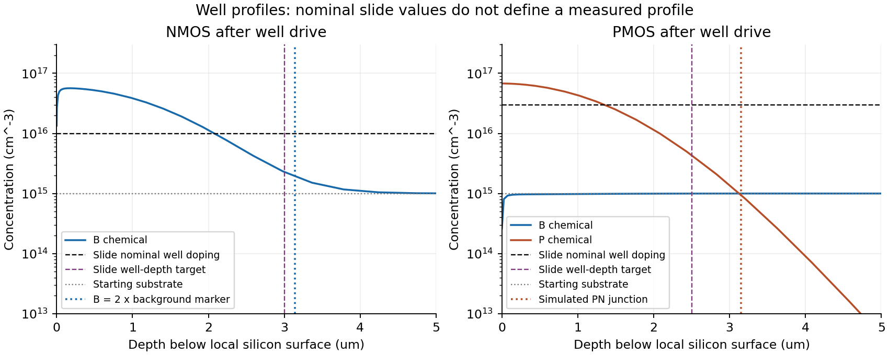
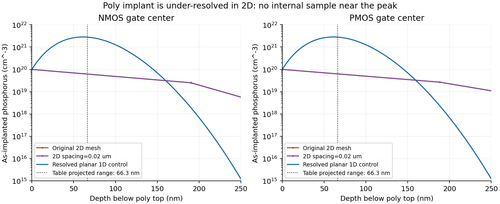
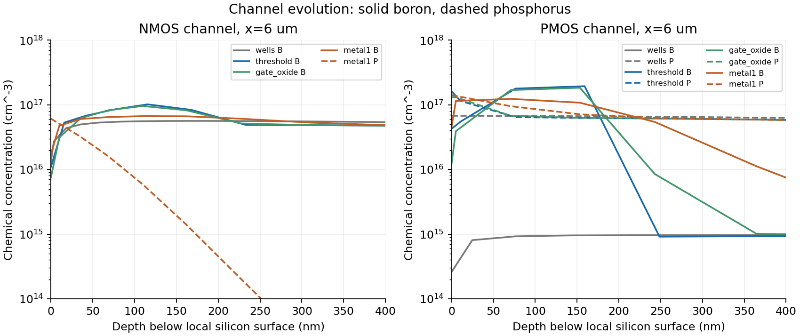
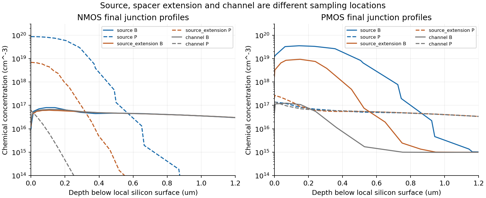
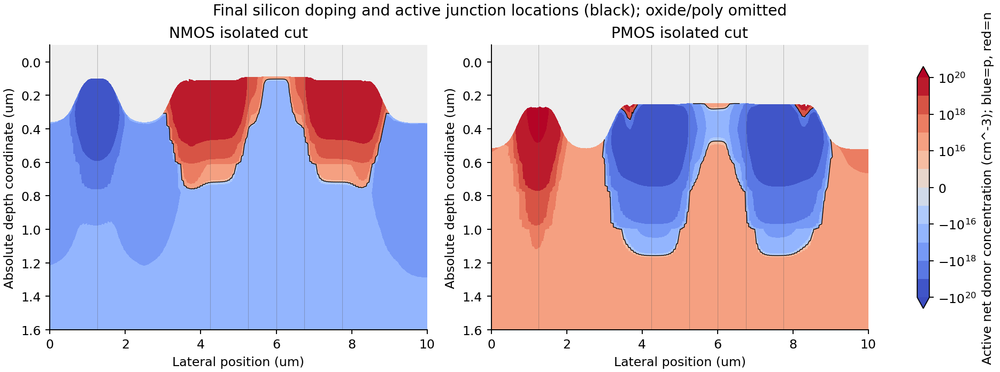
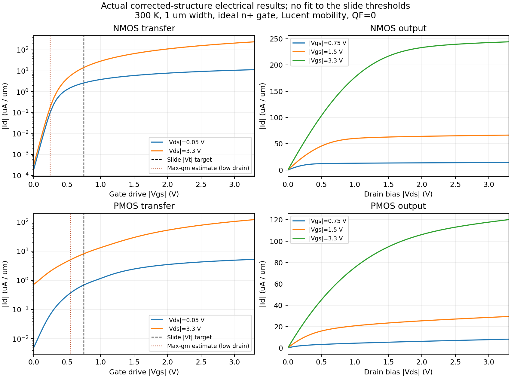

# RIT CMOS presentation audit — 2026-11-17

**The corrected processes run through first metal, but they do not yet reproduce the presentation's process dimensions and electrical targets.** Gate-oxide preservation is verified; doping-profile accuracy and electrical agreement are not. This audit found a reproducible, large poly-implant discretization error before any anneal, an over-deep N-well, oxide thickness deviations, threshold mismatches, and substantial PMOS off-current at the specified 3.3 V supply. No production source, process deck, implant dose, mobility, work function or interface charge was tuned for this audit.

Reference: [Lynn Fuller, Sub-CMOS process presentation](../../rit_process/SubCmos2014_0p5um.pdf), 146 pages, slides dated September 10, 2015. Page references below use the printed page numbers. Text was extracted for all pages; relevant recipe charts, doping illustrations, calculation examples and electrical specifications were also inspected as rendered pages. The title's 0.5 µm is layout lambda: page 11 specifies a **1 µm minimum drawn gate**, not a 0.5 µm transistor.

Evidence directory: [presentation_audit_20261117](../experiments/presentation_audit_20261117/). Reproducible numeric comparison: [JSON](../experiments/presentation_audit_20261117/presentation_comparison.json), [CSV](../experiments/presentation_audit_20261117/presentation_comparison.csv). The JSON records source-PDF, process-deck, simulator, final-structure and electrical-input SHA-256 hashes.

## Scope and acceptance

The audited structures are the fresh `directional_final_fresh_20261117` NMOS and PMOS results, produced with `suprem4/build/native64_rxq2pnrb/src/suprem4`. Both complete all 16 process checkpoints. Electrical runs use these corrected final meshes, with their actual retained gate oxides, rather than historical missing-oxide outputs. The candidate is not promoted to the general launcher.

These are separate 10 µm-wide **process cross sections** of isolated transistors with body contacts. Electrical width is separately set to 1 µm. They are not a combined CMOS layout, inverter or full wafer simulation. The presentation's lateral P-well/N-well boundary example on page 54 cannot be validated from separate isolated cuts. The current process ends at patterned first aluminum, before forming-gas sinter and the second-metal sequence. “Final” below means that current first-metal endpoint.

A successful solver exit establishes a completed calculation under the stated model. It does not establish profile accuracy, mesh convergence, agreement with silicon measurements or electrical reliability.

## Process input comparison

The selected implant species, nominal incident doses and energies agree with the corresponding slides. This is an **input check**, not evidence that the represented profiles contain those doses.

| Operation | Presentation prescription | Pages | Current input |
|---|---|---|---|
| N-well | P, 9.5×10¹² cm⁻², 125 keV | 38 | Same |
| P-well, improved variant | BF₂, 8×10¹² cm⁻², 110 keV | 54 | Same; deliberately uses improved variant |
| P-well, legacy alternative | B, 2×10¹³ cm⁻², 35 keV | 50 | Not selected |
| NMOS field channel stop | B, 8×10¹³ cm⁻², 100 keV | 66 | Same nominal implant, idealized mask |
| Blanket threshold adjustment | B, 7×10¹¹ cm⁻², 60 keV | 75 | Same |
| Additional PMOS threshold adjustment | B, 2.6×10¹² cm⁻², 60 keV | 77 | Same |
| Both polysilicon gates | P, 2×10¹⁶ cm⁻², 50 keV | 87 | Same command; profile fails resolution control |
| NMOS LDD | P, 2.5×10¹³ cm⁻², 60 keV | 99 | Same |
| PMOS LDD | B, 4×10¹³ cm⁻², 50 keV | 102 | Same |
| NMOS source/drain; n-type body contact | P, 2×10¹⁵ cm⁻², 60 keV | 109 | Same |
| PMOS source/drain; p-type body contact | B, 2×10¹⁵ cm⁻², 50 keV | 112 | Same |

Starting silicon is (100), p-type B≈10¹⁵ cm⁻³ as specified. Both gates are n+ poly in the presentation; a modern p+ PMOS gate would change the technology rather than reproduce it. Masks are assumed 2D windows, not digitized mask artwork. Implant angle/channeling and actual equipment conditions are not fully specified or qualified here.

### Furnace schedules and missing operations

Total modeled minutes include push, stabilization, ramp, soak, anneal where present, cooling and pull. Ambient-specific segments were compared with the charts; matching total time alone is insufficient.

| Furnace recipe | PDF page | Slide total (min) | Current total (min) | Finding |
|---|---:|---:|---:|---|
| 250 first pad | 24 | 144 | 144 | Segment durations agree |
| 330 well-mask oxide | 43 | 159 | 159 | Segment durations agree |
| 10 well drive | 56 | 734 | 734 | Segment durations agree |
| 250 second pad | 59 | 144 | 144 | Segment durations agree, including 12 min pull |
| 406 LOCOS | 68 | 202 | 202 | Segment durations agree |
| 311 Kooi | 73 | 117 | 117 | Segment durations agree |
| 215 gate oxide | 81 | **117** | **122** | **An extra 5 min at 900 °C in N₂ is inserted by the recipe helper's default anneal** |
| 120 poly activation | 88 | 117 | 117 | Segment durations agree; no extra anneal hold |
| 280 source/drain activation | 116 | 127 | 127 | Segment durations agree |

Ramps use constant-temperature midpoint intervals no larger than 50 °C; ramp-discretization convergence is untested. Wet oxidation uses a single `weto2` ambient rather than a furnace flow/partial-pressure model for the specified O₂/H₂ mixture. This is an unqualified approximation, not a demonstrated explanation for all overgrowth. LOCOS stress coefficients come from a SUPREM example, not a fit to these wafers. Subsequent thin oxidation uses the deck's vertical-growth approximation.

Nitride deposition's 810 °C/25 min and poly deposition's 610 °C/55 min thermal exposures are not included as deposition-time diffusion. Spacer etching is idealized geometric removal of 0.5 µm of oxide; page 107 instead lists different finite rates for thermal oxide, TEOS, annealed TEOS and resist over a five-minute etch. The model does not distinguish all those oxide films or plasma effects. Aluminum is geometrically deposited by a normal offset rather than a sputter-transport model.

The **400 °C forming-gas sinter** (pages 129–130, including 30 min soak) is absent. Neither hydrogen passivation nor its electrical consequences are simulated. Pages 134–142 add second ILD, vias and M2; these operations are absent. Page 144's future 0.5 µm STI/dual-poly technology is a different process, not a substitute for the present LOCOS deck.

## Film dimensions against stage-specific slide labels

Vertical thickness is measured by intersections with the actual material partition. Channel is x=6 µm, field x=2.5 µm; these locations are not interchangeable. Values are rounded for reporting.

| Quantity / checkpoint | Reference | NMOS | PMOS | Assessment |
|---|---:|---:|---:|---|
| First pad oxide / `pad` | 50 nm | 42.23 nm | 42.23 nm | −15.5% |
| Well mask after nominal 25 nm oxide strip / `well_mask` | NMOS pad 25 nm; PMOS mask 275 nm | 17.23 nm | 361.13 nm | Pad undergrowth; well-mask overgrowth |
| Nitride / `locos_mask` | 150 nm | 150.00 nm | 150.00 nm | Geometric deposition agrees |
| Field oxide after pad strip / `locos` | 600 nm, p69 | 676.78 nm | 673.31 nm | +12.8%, +12.2% |
| Kooi oxide / `threshold` | 100 nm | 103.80 nm | 104.52 nm | +3.8%, +4.5% |
| Retained gate oxide / `metal1` | 15 nm | **16.67 nm** | **16.97 nm** | **+11.2%, +13.1%** |
| Thermal field oxide before ILD / `annealed` | 500 nm in later cross sections | 629.28 nm | 625.90 nm | +25.9%, +25.2%; reference labels vary |
| Added ILD at field | 500 nm, p117/118 | 500.00 nm | 500.00 nm | Geometric deposition agrees |
| Poly thickness at final gate center | 500 nm | 500.00 nm | 499.99 nm | Geometry agrees; doping does not |
| First aluminum nominal normal offset | 750 nm | Input 750 nm | Input 750 nm | Nominal input agrees; sputter step coverage unvalidated |

The PDF is inconsistent about field oxide: page 11 and the poly diagram on page 85 say 600 nm, while pages 78, 97 and 133 say 500 nm after later processing. Therefore the audit preserves the stage labels instead of treating 600 nm as a universal final target. Relative to 600 nm, pre-ILD values are +4.9%/+4.3%; relative to the later 500 nm label they are +25.9%/+25.2%. At final metal the **total** field oxide column is 1129.28/1125.90 nm because it includes the added 500 nm ILD. That is not a 1.13 µm thermal LOCOS thickness.

The ILD detail pages specify 500 nm whereas page 17's summary says 400 nm; the decks explicitly select the detail recipe. The as-grown well-mask oxide is approximately 386.13 nm, inferred by adding the prescribed 25 nm removal to the saved 361.13 nm; there is no saved pre-strip checkpoint for direct measurement. A metal-filled contact column is thicker than the nominal film because it spans a step; comparing its full vertical extent with 750 nm would be an invalid thickness test.

The gate oxide is unchanged between `annealed` and `metal1` at all five accepted probes, and every downward gate edge has an oxide neighbor. Its excess thickness originates upstream; the contact-etch shielding repair did not create this thickness mismatch.

## Doping profiles and junctions

[Profile metrics](../experiments/presentation_audit_20261117/profile_metrics.json) and [224 CSV profiles](../experiments/presentation_audit_20261117/profiles/) cover **both devices × 16 checkpoints × seven locations**. Locations in µm: body 1.25, field/channel-stop 2.5, source 4.25, source extension 5.25, channel 6.0, drain extension 6.75, drain 7.75. Stages: `initial`, `pad`, `well_mask`, `wells`, `locos_mask`, `locos`, `threshold`, `gate_oxide`, `poly_doped`, `gate`, `ldd`, `spacers`, `source_drain`, `annealed`, `contacts`, `metal1`.

Profiles are exact vertical cuts through the represented piecewise-linear triangle fields, not nearest-node samples. CSVs retain absolute y and depth below the **local silicon surface**, chemical B/P, active B/P and both net concentrations. Interface material sides are kept distinct. Integrals convert µm to cm. This measures what the mesh represents; it does not prove the mesh resolves the continuum profile. Chemical dose, electrically active concentration and net compensated doping are different quantities. Final retained sheet dose also need not equal incident dose after screening, segregation, diffusion and lateral transport.

### Wells after drive

| Quantity at channel center / `wells` | NMOS P-well | PMOS N-well |
|---|---:|---:|
| Chemical B at silicon surface | 1.34×10¹⁶ cm⁻³ | 2.61×10¹⁴ cm⁻³ |
| Chemical P at silicon surface | 0 | 6.77×10¹⁶ cm⁻³ |
| Majority well species at 0.5 µm | B: 5.21×10¹⁶ cm⁻³ | P: 6.01×10¹⁶ cm⁻³ |
| Integrated well species in silicon | B: 8.47×10¹² cm⁻², including substrate | P: 9.01×10¹² cm⁻² |
| Well-depth observation | B=2×substrate marker: 3.137 µm | PN junction: **3.153 µm** |
| Page 11 nominal well depth | 3.0 µm | 2.5 µm |

The N-well junction is **26.1% deeper** than the stated target immediately after the well drive; it reaches approximately 3.301 µm at the final channel cut. The P-well is p-type in a p-type substrate, so it has **no bottom PN junction**. The 3.137 µm concentration marker is explicitly defined for diagnostics; it is not proof of agreement with a 3.0 µm junction specification.

Page 11's nominal N/P well concentrations are 3×10¹⁶/1×10¹⁶ cm⁻³. They do not define a unique surface concentration, peak or measured profile. The N-well's implanted sheet divided by its roughly 3.15 µm depth is about 2.86×10¹⁶ cm⁻³, despite a much higher surface value. The improved BF₂ P-well option on page 54 has 8×10¹² cm⁻² over roughly 3 µm, already implying an average order 2.7×10¹⁶ cm⁻³ before losses; it is not fully reconciled with page 11's nominal 1×10¹⁶ label. Thus reporting every point above the nominal label as a concentration error would be misleading. The page-54 Silvaco image is a lateral well-boundary contour illustration, not tabulated SIMS data for the current vertical cut.

### Poly implant: demonstrated spatial discretization failure

A diagnostic replay starts from each accepted gate-oxide checkpoint, deposits the same 500 nm poly and applies the prescribed **P 2×10¹⁶ cm⁻², 50 keV**, then saves immediately **before activation**. This separates implant representation from subsequent diffusion and segregation.

| As-implanted control | Gate-center represented P sheet | Fraction of prescribed dose |
|---|---:|---:|
| NMOS production 2D deposition | **1.3274×10¹⁵ cm⁻²** | **6.64%** |
| PMOS production 2D deposition | **1.3600×10¹⁵ cm⁻²** | **6.80%** |
| Planar 1D, 10 poly divisions | 1.99615×10¹⁶ cm⁻² | 99.807% |
| Planar 1D, 50 divisions | 1.99886×10¹⁶ cm⁻² | 99.943% |
| Planar 1D, 250 divisions | 1.99996×10¹⁶ cm⁻² | 99.998% |

The same 2D implant gives roughly 2×10¹⁶ cm⁻² at some other lateral locations. Its gate-center first interior depth is approximately 190 nm, missing the profile peak near 62 nm (table Rp=66.3 nm, σ=28.4 nm). The stored center maximum is about 9.92×10¹⁹ cm⁻³ at the poly surface; the resolved 1D control peaks near 2.82×10²¹ cm⁻³. The 1D model can represent the requested dose; the production 2D discretization fails to sample it adequately.

Increasing deposition divisions and requesting 0.04→0.02→0.01 µm spacing did **not** establish convergence. NMOS center sheet stayed at 1.3274×10¹⁵ for the first two controls and fell to 1.1376×10¹⁵ for the finest request. PMOS 0.02 µm remained at 1.3600×10¹⁵. More vertices were created without adequate interior sampling at the implant peak. Source inspection finds that deposition builds a skeleton and triangulates it using boundary-derived sizing; these controls do not guarantee the required interior depth resolution.

This is a root numerical problem to repair with enforced interior sizing and conservative implant projection, not a reason to increase the incident dose. Width-averaged represented P immediately after implantation is only about 1.33×10¹⁶ cm⁻² for NMOS and 1.31×10¹⁶ for PMOS. It drops further after activation; the thermal balance, boundary flux and segregation contribution to that further change have **not** been fully isolated by this audit. The pre-anneal failure already invalidates profile qualification.

Evidence: [2D inventory](../experiments/presentation_audit_20261117/poly_implant_inventory.json), [deposition-setting controls](../experiments/presentation_audit_20261117/poly_refinement/results.json), [resolved 1D controls](../experiments/presentation_audit_20261117/poly_1d_reference/results.json), replay inputs/logs/structures in the neighboring directories.

### Channel evolution and final source/drain profiles

The final NMOS center has P≈6.09×10¹⁶ and B≈1.74×10¹⁶ cm⁻³ at the silicon surface, yielding a thin n-type layer about **12.7 nm** deep. Phosphorus at the channel appears after poly processing and subsequently spreads during activation. The PMOS surface remains n-type, with P≈1.41×10¹⁷ and B≈4.68×10¹⁶ cm⁻³, above a compensated/buried p-type interval approximately **34–226 nm** deep. Those observations matter to threshold and leakage; this audit does not prove which mechanism dominates the electrical deviations.

| Final PN depth below local Si surface | NMOS | PMOS |
|---|---:|---:|
| Source, x=4.25 µm | 0.610 µm | 0.903 µm |
| Drain, x=7.75 µm | 0.607 µm | 0.902 µm |
| Source extension, x=5.25 µm | 0.326 µm | 0.576 µm |
| Drain extension, x=6.75 µm | 0.354 µm | 0.643 µm |

These are measured profile features, **not passes against an unstated S/D junction-depth specification**. Presentation cross sections are schematic; no numeric measured final S/D profiles or acceptance depths were supplied. The extension cuts differ from the central heavily implanted contacts. The audit includes full chemical and active profiles rather than substituting incident dose for activated doping. The electrical export uses active concentrations, with full ionization assumed.

## Electrical comparison at the specified 3.3 V supply

Both low-drain transfer sweeps and **eight added operating-bias sweeps** completed: for each device, a transfer curve at |Vds|=3.3 V and output curves at |Vgs|=0.75, 1.5 and 3.3 V. Each recorded sweep has 67 finite points with 50 mV spacing. All eight added solver executions returned zero without ERROR/DIVERGED indicators. The largest reported terminal KCL residual across these curves is about 2.3×10⁻¹⁵ A. Independent transfer/output continuation paths agree on the on-current endpoint to better than 3×10⁻⁹ relative. These are useful consistency checks, not mesh convergence tests.

| Electrical quantity | Presentation | NMOS result | PMOS result |
|---|---|---:|---:|
| Threshold, max-gm tangent at |Vds|=0.05 V | +0.75 / −0.75 V, p11 | **+0.246 V** | **−0.555 V** |
| Signed threshold error | — | −0.504 V | +0.195 V |
| Threshold at 100 nA/µm, low drain | No criterion specified | +0.246 V | −0.301 V |
| Off-current, Vgs=0, |Vds|=0.05 V | No numeric target | 0.181 nA/µm | 4.878 nA/µm |
| Off-current, Vgs=0, |Vds|=3.3 V | No numeric target | **0.301 nA/µm** | **721.8 nA/µm** |
| On-current, |Vgs|=|Vds|=3.3 V | No numeric target | **244.1 µA/µm** | **120.2 µA/µm** |
| On/off ratio at 3.3 V drain | No numeric target | ≈8.12×10⁵ | **≈166.5** |
| Id at 3.3 V drain, 0.75 V gate drive | No numeric target | 14.40 µA/µm | 8.14 µA/µm |
| Id at 3.3 V drain, 1.5 V gate drive | No numeric target | 66.51 µA/µm | 29.38 µA/µm |

The PMOS **0.722 µA/µm off-current at 3.3 V** is a serious finding hidden by the earlier 50 mV-only characterization. It exceeds the 100 nA/µm threshold criterion even at zero gate bias, so high-drain constant-current PMOS threshold and DIBL are not bracketed and are not extrapolated. NMOS 100 nA/µm DIBL is approximately 9.58 mV/V. A local four-point low-drain log-current fit over 0–0.15 V gives 86.2 mV/dec NMOS and 203.4 mV/dec PMOS; the PMOS interval spans less than one decade, so these are limited-window diagnostics, not qualified broad-range subthreshold swing measurements.

The max-gm threshold is the signed tangent x-intercept minus |Vds|/2, analogous to the extraction in the [Silvaco ATLAS user's manual hosted by RIT](https://ridl.cfd.rit.edu/products/Manuals/Silvaco/atlas_users.pdf). We use the largest adjacent-point slope with 50 mV sampling. Page 11 does not specify an extraction convention, so an exact apples-to-apples Vt test is unavailable. The large NMOS deviation remains clear; the strong PMOS dependence on extraction method is itself a reason to inspect its channel electrostatics.

### Model assumptions and limits of the reference

Electrical simulation uses Genius, 300 K, drift-diffusion DDML1, Lucent mobility, Fermi statistics, 1 µm width, active B/P with full ionization, ideal zero-resistance ohmic contacts, an ideal n+ gate work function of 4.17 eV, and explicit **QF=0** at silicon/oxide interfaces. Poly and gate metal are merged into the ideal gate conductor, omitting poly depletion. Interface traps, hydrogen passivation, calibrated contact resistance, impact-ionization/breakdown qualification and process-dependent gate work function are not established. In particular, the ideal conductor treatment hides some electrical consequences of the demonstrated poly-dose error. Electrical values describe this model and these represented profiles, not a calibrated prediction of fabricated devices.

Page 74 is a threshold-calculation example using a desired PMOS Vt of −1 V and Nss=3×10¹¹ cm⁻². It is not the final ±0.75 V device specification. Page 84's SCA example uses a **400 Å** oxide and reports test-sample doping/charge/traps; it is not a measured final **150 Å** gate transistor curve. Page 146 asks students to use surface-state density 10¹¹ cm⁻² for a calculation. Surface-state density alone does not specify fixed-charge sign or trap occupancy, so it cannot simply be equated to positive QF. For scale only, a hypothetical positive fixed sheet of 10¹¹ cm⁻² would shift ideal threshold by about −0.077 to −0.079 V at these oxide thicknesses; that is not a justified calibration or a repair for the profile failure.

The presentation provides process prescriptions and nominal Vt/Vdd targets, but no numerical final Id–Vg/Id–Vd curves, on/off-current limits or common extraction protocol. Therefore no claim of current agreement is possible. This audit supplies actual transfer/output curves, and labels their currents as characterization rather than inventing slide targets. A converged 3.3 V DC sweep does not demonstrate breakdown margin or long-term oxide reliability.

Numeric evidence and exact electrical input hashes: [electrical metrics](../experiments/presentation_audit_20261117/electrical_metrics.json), [eight execution records](../experiments/presentation_audit_20261117/electrical/executions_verified.json). Raw decks, terminal currents, solver logs and final fields are in `electrical/{nmos,pmos}/{transfer_vd3p3,output_vg0p75,output_vg1p5,output_vg3p3}/`. Baseline low-drain evidence is in `../experiments/directional_etch_20261117/electrical/`.

## Repair priorities supported by this audit

1. **Repair process-aware interior mesh sizing and implant projection first.** Enforce actual sampling around projected range/straggle, material interfaces and thin layers; assess the achieved mesh rather than requested deposition settings. Use a conservative projection/integral treatment. Require planar 1D/2D agreement and local/global dose convergence over lateral shifts and actual mesh refinements before accepting the poly profile. Do not compensate by multiplying dose.
2. Audit the implant-to-activation inventory with explicit material transfers and boundary fluxes. Establish converged channel, poly and S/D profiles through oxidation/segregation before treating electrical differences as parameter-calibration problems. Other implants also need convergence; the poly control is a demonstrated failure, not proof that all others are sound.
3. Correct the recipe-215 extra anneal, account for missing deposition thermal exposures and explicitly choose the intended first-metal/sinter/full-two-metal endpoint. Re-run the complete process and compare stage profiles after each change. Model forming-gas effects only with justified electrical assumptions; a 400 °C time command alone does not implement hydrogen passivation.
4. Validate oxidation against the individual pad, mask, Kooi, field and gate targets using defensible furnace ambient/temperature models and finer ramp controls. Do not tune a single oxide parameter to match the gate while ignoring the divergent pad and mask results. Retain the stage-specific field-oxide ambiguity in the acceptance specification.
5. Re-export the corrected profiles, qualify electrical mesh convergence and threshold extraction, then investigate PMOS high-drain leakage and channel compensation with off-state fields/terminal decomposition. Only after this should measured interface charge/traps, poly depletion, work function, mobility and contact parameters be calibrated. Require low- and operating-drain transfer curves and output curves; preserve the raw failed comparisons.

No production changes were made in response to these findings during this audit. The gate-oxide geometry repair remains verified. **Presentation agreement and profile-resolution qualification remain false.**
